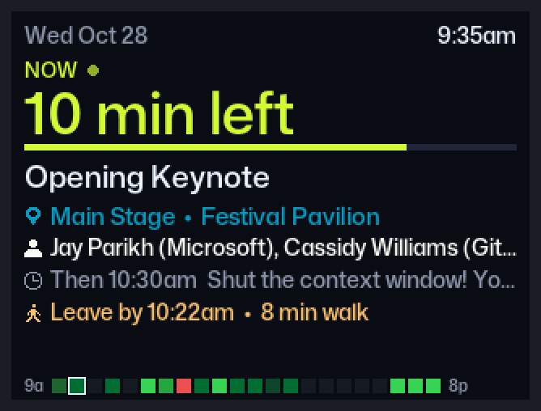
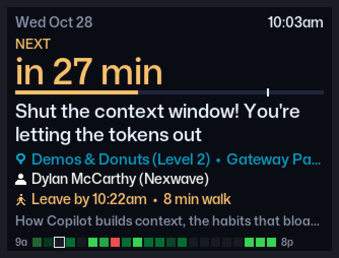
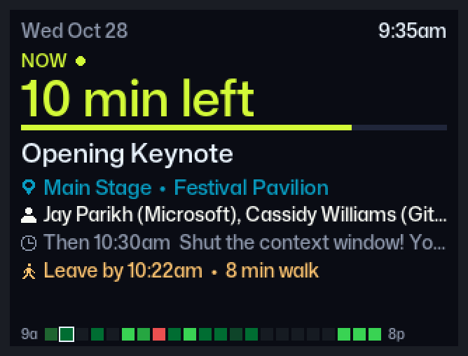
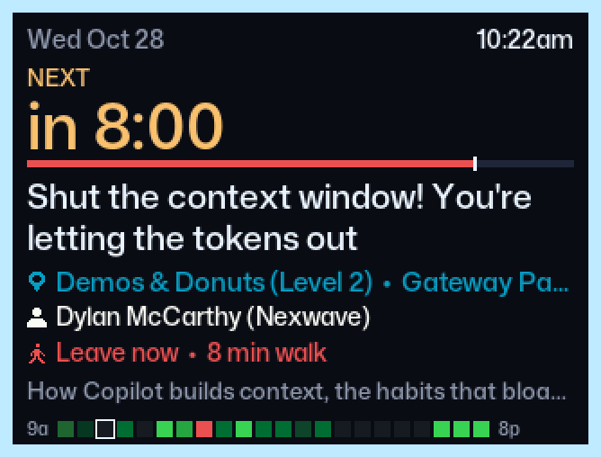
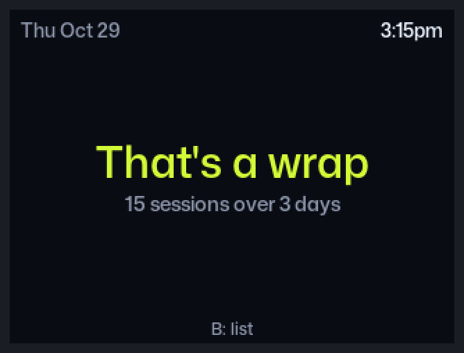
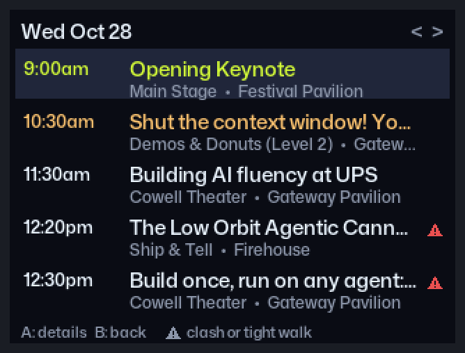
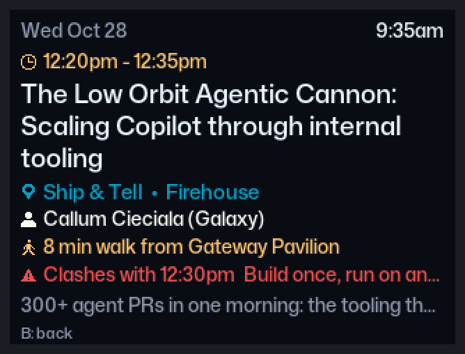
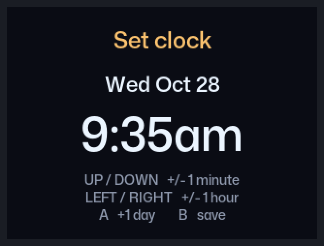
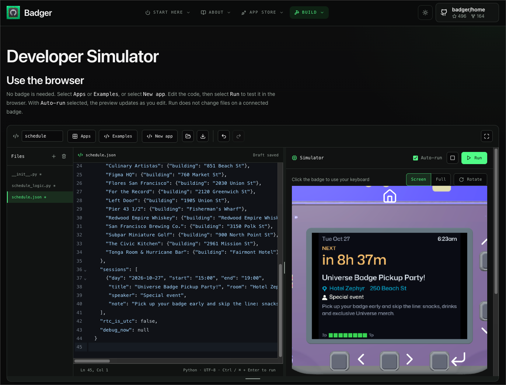
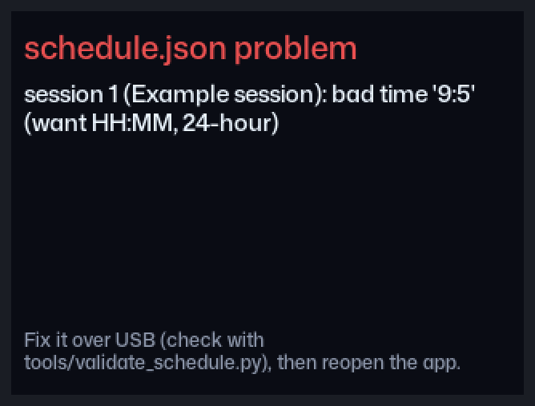

# Github Universe 2026 Badge App: Schedule

An offline GitHub Universe 2026 schedule that counts down to your next session and tells you when to walk to the next session.

It shows your next session with a live countdown, the room and building, and how long the walk is. When it's time to leave, it pulses the badge's case lights. Your sessions live in a `schedule.json` file on the badge, so the app doesn't needs Wi-Fi or any extra hardware. `secrets.py` is only used if the badge clock runs on UTC (see [How the clock works](#how-the-clock-works)). [full-schedule.md](full-schedule.md) lists every session in the Universe catalog, ready to copy into `schedule.json`.

> **Status:** the app runs in the [Badger Developer Simulator](#try-it-in-a-simulator) and has been checked on a computer with the validator and the preview tool, but hasn't been run on a real badge yet. [changelog.md](changelog.md) lists what still needs checking on the device.



The screenshots in this README come from the [preview tool](#preview-on-a-computer). A light-blue frame means the case lights are on. [preview/sheet.png](preview/sheet.png) shows every screen on one page.

## What it shows

**Now screen** (opens by default)
- The session you're in, with the time left and a pulsing green dot. Between sessions it shows the next one, with a countdown such as "in 12 min".
- The title, room and building, and speaker.
- A walk hint when the next session is in a different building from your previous one, for example "Leave by 10:52am • 8 min walk". It turns red when the gap is too short for the walk, and once it's time to leave.
- A bar under the countdown. It fills green during a session and gold over the last hour before your next one, then turns red once you're past the time to leave. A white tick marks when to leave.
- The session's note.
- A row of squares along the bottom, one per half hour of the day, shaded like a GitHub contribution graph by how much of that half hour is booked. Red squares are clashes.
- After your last session, "That's a wrap".

| Next session, with a walk hint | During a session |
| --- | --- |
|  |  |

| Time to leave (lights pulse fast) | After your last session |
| --- | --- |
|  |  |

**Day list:** each day's sessions with time, title and room. The current session is green, the next one gold, and past ones dimmed. A ⚠ marks a clash or a walk you can't make in time.

**Detail:** the full title, speaker, room, the walk from the session before, any clash, and the full note.

| Day list | Detail |
| --- | --- |
|  |  |

**Case lights:**

| When | Lights |
| --- | --- |
| 10 minutes before your next session | slow pulse |
| Past the time you need to leave | fast pulse |
| First 5 minutes of a session | solid |
| Any other time | off |

The time to leave is the session's start minus the walk. The walk is `different_building` minutes if the session is in a different building from your previous one that day, otherwise `same_building` minutes.

## Controls

| Button | Now screen | Day list | Detail |
| --- | --- | --- | --- |
| B (tap) | Open the day list | Back to Now | Back to the day list |
| B (hold 2 seconds) | Set the clock | | |
| A | | Open details | Back to the day list |
| UP / DOWN | | Move through sessions | |
| LEFT / RIGHT | | Previous / next day | |

In the code, B is `BUTTON_SELECT` (the Select control) and A is `BUTTON_BACK` (the Back control). The A and B names follow spf13's badge apps.

On the **Set clock** screen, UP / DOWN change the time by 1 minute and LEFT / RIGHT by 1 hour (hold to repeat). A adds a day, and B saves.



The badge's HOME button closes the app and turns the case lights off.

**On a stock Tufty 2350 or the Badgeware simulator**, which have only A, B, C, UP and DOWN, the controls move:

| Action | Universe badge | Stock Tufty / simulator |
| --- | --- | --- |
| Open details; Set clock +1 day | A | C |
| Previous day; Set clock −1 hour | LEFT | A |
| Next day; Set clock +1 hour | RIGHT | none (days wrap around, so A reaches every day) |

B and UP / DOWN work the same on both. The on-screen hints show the right letters for each device.

## Install

You need this `apps/schedule/` folder and `tools/validate_schedule.py` from the same repository. Run the commands below from the repository root.

### 1. Make your schedule

Start from the sample. It lists every room in the Universe session catalog and has one example session.

```bash
cp apps/schedule/schedule.json.sample apps/schedule/schedule.json
```

This replaces any `schedule.json` that's already there.

Then replace the example in `sessions` with your own picks.

**The quick way: copy sessions from [full-schedule.md](full-schedule.md).** It lists every session in the Universe 2026 catalog (161 time slots, Oct 26-29), grouped by day and start time. Each one has its full description and speakers, then a JSON block ready to paste:

1. Find a session you want and copy its JSON block.
2. Paste it into the `"sessions": [ ... ]` list in `schedule.json`. Put a comma between sessions, but not after the last one.
3. Repeat for each session, then [check the file](#2-check-it).

The blocks already use the room names from the sample's `rooms` map, so walk hints work without any changes. Each `note` is a shortened description of up to 140 characters. Change it to whatever helps you on the day, such as why you're going or a question to ask.

**Writing a session yourself.** For anything not in the catalog, such as a meeting, use the same format:

```json
{"day": "2026-10-28", "start": "09:00", "end": "09:45",
 "title": "Opening Keynote", "room": "Main Stage",
 "speaker": "Cassidy Williams (GitHub)",
 "note": "New announcements, live demos and a few surprises."}
```

| Field | Required | Format |
| --- | --- | --- |
| `day` | yes | `YYYY-MM-DD` |
| `start`, `end` | yes | 24-hour `HH:MM` in venue time (Pacific). `end` must be later than `start` on the same day. |
| `title` | yes | Text |
| `room` | no | A name from `rooms`, exactly as written there. Use `""` if you don't know it yet. |
| `speaker` | no | Text |
| `note` | no | A short reminder, shown on the Now and Detail screens |

Sessions can be in any order; the app sorts them by start time. Overlapping sessions are allowed, and the app marks them as clashes.

**Picking the room.** Sessions copied from [full-schedule.md](full-schedule.md) already have the right `room`. If you're writing one yourself, the catalog shows each location as "Room @ Building", for example "Main Stage @ Festival Pavilion". Use the part before the "@" as `room`. A few rooms keep a floor or area in their name:

| Catalog location | `room` |
| --- | --- |
| Demos & Donuts @ Gateway Pavilion, Level 2 | `Demos & Donuts (Level 2)` |
| Workshops @ Gateway Pavilion, Level 1 | `Workshops (Level 1)` |
| The Speakeasy @ GitHub Central, Festival Pavilion | `The Speakeasy (GitHub Central)` |
| Sandbox @ Fort Mason Building C, Founders Inc., 3rd Floor | `Sandbox, 3rd Floor` |
| BATS Theatre @ Fort Mason Building B, 3rd Floor | `BATS Theatre, 3rd Floor` |

For a place that isn't in the catalog, such as a meeting room, add it to `rooms` with its building:

```json
"EC-1813": {"building": "GitHub Expert Center"}
```

Walk hints compare buildings, so rooms in the same building don't get one.

**Other settings** (the sample's values are fine for most people):

| Setting | Meaning |
| --- | --- |
| `walk_minutes` | Minutes to allow between sessions: `same_building` and `different_building`. Defaults are 5 and 10. |
| `rtc_is_utc` | Set to `true` if the badge clock runs on UTC rather than local time. See [How the clock works](#how-the-clock-works). |
| `debug_now` | `null` normally. For testing, a fake start time such as `"2026-10-28 08:52"`. |
| `_readme` | A note for people editing the file; the app ignores it. |

### 2. Check it

```bash
python3 tools/validate_schedule.py
```

This needs only Python 3, with no extra packages. It checks `apps/schedule/schedule.json`, then prints each day's agenda, any overlaps or walks you can't make in time, and warnings such as a room missing from `rooms`. It exits with an error if the badge couldn't load the file.

To see what the badge would show at a given time, add `--at` (you can repeat it):

```bash
python3 tools/validate_schedule.py --at "2026-10-28 10:45" --at "2026-10-29 08:00"
```

The validator uses the same `schedule_logic.py` as the badge, so a file that passes here will load on the badge.

### 3. Copy it to the badge

1. Plug the badge into your computer with USB-C.
2. On the badge's home menu, open **USB Disk**. The badge shows up on your computer as a drive, such as `/Volumes/BADGER` on macOS or `F:\` on Windows.
3. Copy four files into `apps/schedule/` on that drive: `__init__.py`, `schedule_logic.py`, `schedule.json` and `icon.png`. The badge doesn't need the other files in this folder.

macOS or Linux (change the drive path to match yours):

```bash
mkdir -p /Volumes/BADGER/apps/schedule
# -X stops macOS adding "._" metadata files to the badge
cp -X apps/schedule/__init__.py apps/schedule/schedule_logic.py apps/schedule/schedule.json apps/schedule/icon.png /Volumes/BADGER/apps/schedule/
```

On Linux, leave out `-X`.

Windows PowerShell (change `F:` to your drive letter):

```powershell
New-Item -ItemType Directory -Force F:\apps\schedule | Out-Null
Copy-Item .\apps\schedule\__init__.py, .\apps\schedule\schedule_logic.py, .\apps\schedule\schedule.json, .\apps\schedule\icon.png F:\apps\schedule\
```

4. Eject the drive. The badge restarts into MonaOS.

To update your schedule later, edit `schedule.json`, check it again, and copy only that file.

**The menu icon.** The app appears in the home menu as **Schedule**, named after its folder. The stock Universe 2026 menu draws only its own built-in icons, so on most badges the app gets the generic default icon. `icon.png` only shows if the badge's menu has the icon patch from the `badger` repository (the Universe 2026 badge's app repository): its `badge/apps/menu/app.py`, installed as described under "Menu icon patch" in its `hardware/USB_SERIAL.md`. The app works the same either way.

### 4. First run

Open the schedule app from the badge's home menu and check the time in the top right corner.

- If it says **Clock not set**, hold B for 2 seconds, set the time, and press B to save.
- If the time is wrong, hold B for 2 seconds on the Now screen to correct it.

## How it works

**Files on the badge**
- `__init__.py` is the MonaOS app: the screens, buttons and case lights.
- `icon.png` is the home-menu icon: a calendar page holding a small contribution graph, 48×48 (pixel art drawn at 24×24 and doubled).
- `schedule_logic.py` loads and checks `schedule.json` and works out the current and next sessions, walk hints, clashes, the progress bar, the day strip and the case-light timing. It doesn't use anything specific to the badge, so the same file runs on the badge (MicroPython) and in the computer tools (Python 3).
- `schedule.json` is your schedule. The app reads it from its own folder (or from `/` in the simulator) once, when it opens. If the file is missing or has a mistake, the app shows the problem on screen instead of crashing.

### How the clock works

The app reads the badge's clock as local time. It doesn't sync the time over Wi-Fi.

- **Corrections** you save on the Set clock screen are stored on the badge in `/state/schedule_clock.json`, as an offset from the badge clock, so they last until you change them.
- **A badge clock that has reset** (it reads earlier than 2026) shows the Clock not set screen. Saving then sets the badge clock itself.
- **A badge clock that runs on UTC:** set `"rtc_is_utc": true` in `schedule.json`. The app then adds `TIMEZONE` from `secrets.py` on the badge (hours from GMT, default `-7` for Pacific daylight time). That's a line such as `TIMEZONE = -7` in `secrets.py` at the root of the badge drive.
- **`debug_now`** replaces the real clock with a fake time that starts when the app opens and then ticks normally. Use it to see how a session looks without waiting for it. While it's set, the top bar shows a red **DEBUG** and clock corrections aren't saved. The validator warns until you set it back to `null`.

## Preview on a computer

`tools/badge_preview.py` runs the real app code on your computer and draws the screens with the Mona Sans font. It needs Pillow (`python3 -m pip install pillow`) and downloads the font on first run.

```bash
python3 tools/badge_preview.py                                    # mockups of every screen in apps/schedule/preview/
python3 tools/badge_preview.py --live                             # a window you drive with the keyboard
python3 tools/badge_preview.py --live --at "2026-10-28 12:25"     # start at a given time
```

The mockups are the screenshots in this README, so run it again after changing the layout or your schedule. It replaces only the screens it makes, so other images in `preview/`, such as `dev-sim.png`, are kept. Each screen keeps the same file name, such as `preview/day-list.png`, and the tool picks times from your `schedule.json`. A few screens only appear when your schedule has them: `next.png` needs a first session with a note, `next-walk.png` and `leave-now.png` need a walk between buildings that there's time to make, and `in-session.png` and `session-starts.png` need two sessions on the same day.

In the live window, the arrow keys are the d-pad, Z is A, and X is B (hold it for 2 seconds for the clock). `[` and `]` move the time back or forward 5 minutes, and `{` and `}` move it 1 hour. S saves a screenshot to `apps/schedule/preview/live-<time>.png` (git ignores these), and Q or Esc quits.

Text sizes are close to the badge's but not identical, so check final layouts on the device.

### Try it in a simulator

You can also test the app in your browser, without a badge.

**Badger Developer Simulator (Universe 2026 badge).** The [Developer Simulator](https://badger.github.io/simulator/) runs apps on a model of the Universe 2026 badge itself.

1. Open the simulator, select **New app**, and name it `schedule`.
2. Under **Files**, add `__init__.py`, `schedule_logic.py` and `schedule.json`, and paste in each file's contents from this folder.
3. Select **Run**, or tick **Auto-run** to rerun the app as you edit. Click the badge to control it with your keyboard.

**Run** only changes the simulator. It doesn't change files on a connected badge.



**Badgeware simulator (stock Tufty 2350).** The app also runs in the [Badgeware simulator](https://try.badgewa.re), which models a stock Tufty 2350 with fewer buttons (see the [stock Tufty controls](#controls)).

1. In the simulator's file browser, upload `schedule_logic.py` and your `schedule.json`. Uploads go to `/`, which the app also checks.
2. Open or paste `__init__.py` in the editor and press **Run**.

## Troubleshooting

| What you see | What to do |
| --- | --- |
| **schedule.json problem** on the badge (example below) | The message names the session and field. Fix it, run the validator, and copy the file again. |
| **Clock not set** | Hold B for 2 seconds and set the time. |
| Times off by exactly 7 hours | The badge clock runs on UTC. Set `"rtc_is_utc": true`. |
| Red **DEBUG** in the top bar | Set `debug_now` back to `null`. |
| A session shows no building, or a walk hint is missing | Its `room` isn't in `rooms`, or is spelled differently. The validator lists these. |



## Files in this folder

| File | Purpose | Copy to the badge? |
| --- | --- | --- |
| `__init__.py` | The badge app | yes |
| `icon.png` | Home-menu icon, 48×48 | yes |
| `schedule_logic.py` | Schedule logic shared with the computer tools | yes |
| `schedule.json` | Your schedule | yes |
| `schedule.json.sample` | Starting point with every catalog room | no |
| `full-schedule.md` | Every session in the Universe catalog, each with a JSON block to copy into `schedule.json` | no |
| `preview/` | Screenshots used in this README | no |
| `README.md` | This file. Its first sentence is the app's one-line description | no |

Related: [tools/validate_schedule.py](../../tools/validate_schedule.py)
